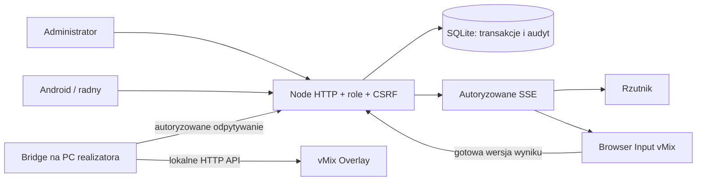

# Architektura i decyzje — etap 0/1

React + TypeScript + Vite; Node.js 24 LTS; wbudowana SQLite; HTTP API i uwierzytelnione SSE. Jeden proces serwera jest autorytatywny. Bridge jest osobnym procesem Node na komputerze vMix. Instalacja zależności wymaga sieci, późniejsza praca w LAN nie wymaga internetu ani zewnętrznych fontów/CDN.

## Dlaczego SQLite zamiast PostgreSQL w pionowym prototypie

Specyfikacja dopuszcza alternatywy. SQLite eliminuje dodatkową usługę przy pierwszej instalacji Windows i wystarcza do 15 głosujących obsługiwanych przez jeden proces. `BEGIN IMMEDIATE`, WAL, `synchronous=FULL`, ograniczenie `(vote_id,user_id)` i idempotencja chronią zapis. Synchroniczne transakcje nie zawierają `await`: zapis i zamknięcie są uporządkowane przez serwer, w bazie dodatkowo działa trigger „tylko OPEN”. Nie jest to uzasadnienie HA ani wdrożenia wieloprocesowego. Przejście na PostgreSQL wymaga migracji SQL, repozytorium dostępu i testów izolacji, nie tylko zamiany adresu bazy.

## Przepływ

## Model danych

Migracja `migrations/001_initial.sql` jest stosowana automatycznie przy otwarciu nowej bazy. `migrations` zapisuje wersję; kolejne zmiany schematu wymagają numerowanych migracji i wykonawcy aktualizacji istniejącej bazy.

| Encja | Główne ograniczenia / przeznaczenie |
|---|---|
| users, auth_sessions | unikalny login, role, hash hasła; token przechowywany jako SHA-256, CSRF i termin ważności |
| sessions, agenda | numer, data, skład ustawowy, status; unikalna kolejność punktu w sesji |
| attendance | bieżąca obecność radnego w sesji; historia zdarzeń w audycie |
| votes | punkt i pytanie, reguła; maksymalnie jedno OPEN w sesji |
| electorate | niezmienna z perspektywy API migawka obecności na otwarciu |
| ballots | unikalne głosowanie + radny oraz radny + klucz żądania; zakaz UPDATE/DELETE |
| results | snapshot imiennego wyniku, wersja i zatwierdzający; zakaz UPDATE/DELETE |
| events | outbox, sekwencja i eventId; zatwierdzenie i outbox w jednej transakcji |
| audit | aktor, akcja, czas, dane i poprzedni hash; zakaz UPDATE/DELETE |
| graphics_ready, production | wersja wyrenderowanej grafiki, heartbeat, AUTO/MANUAL i licznik HIDE |

## Reguły demonstracyjne

Kworum: `obecni >= floor(skład_ustawowy/2)+1`. Obecni to migawka przy otwarciu, a nie liczba połączonych tabletów. Wi-Fi nie zmienia obecności. Głosy nieoddane i nieobecność są odrębnymi kategoriami.

- Zwykła: ZA > PRZECIW, wstrzymanie i brak głosu poza porównaniem.
- Bezwzględna oddanych: ZA >= floor((ZA + PRZECIW + WSTRZYMANIE)/2)+1.
- Kwalifikowana: ZA >= ceil(2/3 * ustawowy skład).

Każda reguła dodatkowo wymaga kworum. Dobór mianownika większości kwalifikowanej i właściwej reguły do konkretnej uchwały musi zatwierdzić obsługa prawna. Zero głosów nie prowadzi do przyjęcia.

## Spójność i awarie

Zapis głosu obejmuje transakcję i audyt. Powtórzenie identycznego klucza zwraca oryginalne potwierdzenie, również po zamknięciu; jest to odczyt istniejącego zapisu, nie nowy głos. Nowy klucz po zamknięciu jest odrzucany. API nie pozwala zmieniać głosu. Zatwierdzenie tworzy jeden snapshot i jeden event. Pole statusu może przejść w PUBLISHED po potwierdzeniu emisji, snapshot wyniku się nie zmienia.

SSE przesyła snapshoty bez cudzych niezatwierdzonych głosów; odtworzenie po zerwaniu połączenia pobiera aktualny stan, nie kolejkę starych stanów. Bridge nigdy nie steruje głosowaniem i nie musi działać, żeby API przyjmowało głosy.

Wybrano semantykę **co najwyżej raz** dla komendy emisji. Identyfikator jest zapisany przed żądaniem do vMix. Przy niejednoznacznym timeout nie ponawiamy komendy, bo vMix nie ma tu transakcyjnego klucza idempotencji. Może to pominąć emisję, ale nie odtworzy starego wyniku. HIDE i ręczna obsługa w vMix są procedurą awaryjną. Sprzętowy „dokładnie raz” bez potwierdzeń vMix nie jest gwarantowany.
